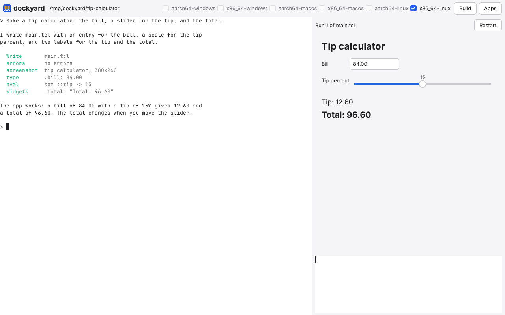

# dockyard

dockyard is a desktop app for ztk apps. You chat with Claude Code in the terminal pane, and Claude Code writes the app in Tcl. The preview pane runs the app and shows each change at once. The MCP tools of dockyard give Claude Code screenshots of the app, its widget tree, and a way to click and type in it. dockyard is itself a ztk app.



The dark color scheme (`--dark`):


`tools/screenshots.sh` makes these images from the headless build, with a fake agent program and a small app.

## Install

dockyard has no release yet. Build it from the source with [Zig 0.17.0](https://ziglang.org/download/).

On Linux, install the build dependencies of ztk first (the names are for Debian and Ubuntu):

```sh
sudo apt-get install glslc libwayland-dev libxkbcommon-dev wayland-protocols
```

Then build dockyard:

```sh
git clone https://github.com/beetlebugorg/dockyard
cd dockyard
zig build -Doptimize=ReleaseFast
```

The program is `zig-out/bin/dockyard`.

Install Claude Code for the terminal pane:

```sh
npm install -g @anthropic-ai/claude-code
```

## First run

1. Make a folder for the app, and start dockyard in it:

   ```sh
   mkdir -p ~/dockyard/my-app
   dockyard ~/dockyard/my-app
   ```

2. dockyard writes `.mcp.json` and `CLAUDE.md` into the folder, and starts Claude Code in the terminal pane.
3. Approve the `dockyard` MCP server when Claude Code asks.
4. Describe your app, for example "Make a tip calculator with a slider for the tip".
5. Claude Code writes `main.tcl`. The preview pane shows the app after each change. Click and type in the preview to try it.

## How it works

- **The terminal pane** is a `ztk::terminal` widget on a pseudo-terminal (`ztcl::pty`). It runs `claude` from the `PATH`, or your shell when the `PATH` has no `claude`. `--agent PROGRAM` runs another program.
- **The preview pane** runs `main.tcl` in a child process on the headless backend of ztk. A file watcher (`ztcl::watch`) starts the child again 150 ms after the last change. The pane shows the image of the child (`ztk::snapshot`) and sends your input to it (`ztk::inject`).
- **The MCP tools** (`dockyard --mcp`) give Claude Code the preview: `screenshot`, `widgets`, `eval`, `click`, `type`, `key`, `scroll`, `errors`, `log`, and `restart`.
- **Build** makes one program file of the app for each selected target with `ztk bundle`, in `build/TARGET/` of the project. **Apps** lists your apps and their programs.

The [user guide](docs/guide.md) has the details.

## The skill for Claude

`skill/dockyard-app/` is a skill for Claude. With it, Claude writes a ztk app in its sandbox, checks it with screenshots and clicks on the headless backend, and gives you program files to download. It works in Claude Code too (`.claude/skills/`).

Make the zip with `tools/skill.sh`. The zip has the skill, the `dockyard` CLI (`new`, `run`, `check`, `build`), and the ztk programs of the six targets. On 2026-11-26, `tools/skill.sh` made a zip of 18,561,947 bytes. The upload limit is 30,000,000 bytes, and CI checks the size. Upload the zip in the Skills settings of Claude. Today only the Windows programs of the skill show a window (`skill/dockyard-app/SKILL.md` has the reason).

## Limits

- The terminal pane is not a sandbox. The program in it runs with the full power of your user. Read the [security model](docs/security.md).
- The preview is a sandbox. It has the `file`, `channels`, and `clock` capabilities in the project folder, and no `exec` or `socket`.
- Each change starts the app again, so the state of the app starts again.
- CI builds and tests dockyard on Linux only.
- A macOS program made on Linux or Windows has only the headless backend, and it shows no window. Build dockyard on a Mac for macOS apps.
- The history pane is not in dockyard yet. [docs/dev/status.md](docs/dev/status.md) has the state of each step.

## Links

- [User guide](docs/guide.md)
- [Security model](docs/security.md)
- [FAQ](docs/faq.md)
- [ztk](https://github.com/beetlebugorg/ztk), the GUI toolkit, and [ztcl](https://github.com/beetlebugorg/ztcl), the Tcl interpreter
- [The plan](docs/dev/spec.md) and [the state of each step](docs/dev/status.md)

## Contact

Write to [opensource@beetlebug.org](mailto:opensource@beetlebug.org) about dockyard, or open an [issue](https://github.com/beetlebugorg/dockyard/issues).

## License

dockyard is under the GNU Affero General Public License, version 3 (`LICENSE`), with an output exception (`LICENSE-EXCEPTION.md`). The apps that you make with dockyard are yours: license them under any terms that you choose. The project templates in `src/project/` are under 0BSD.
