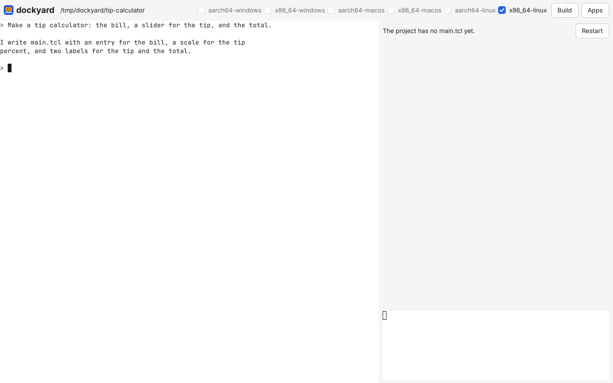
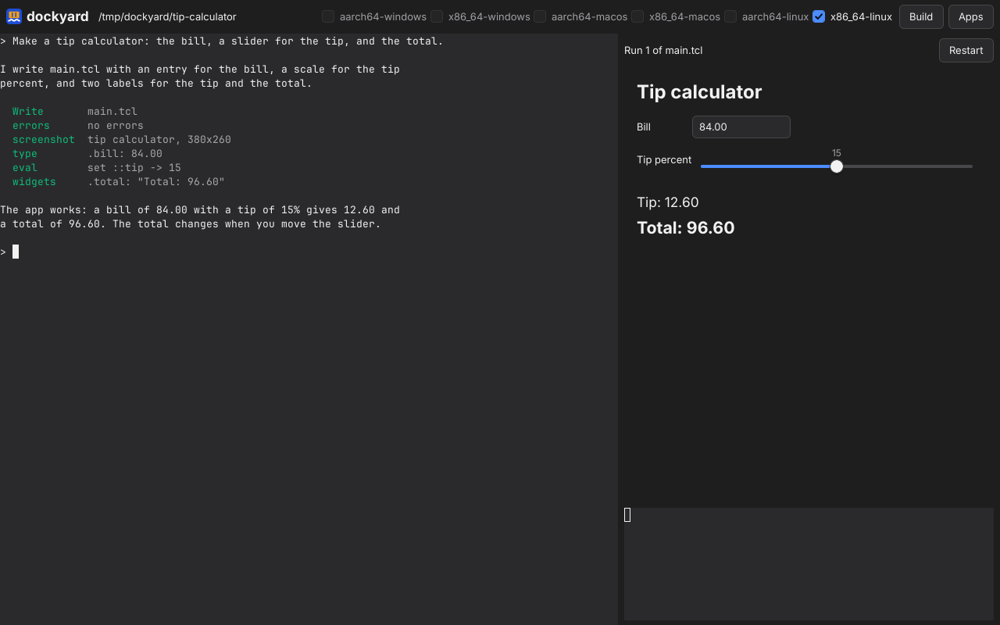

<p align="center"></p>

<h1 align="center">dockyard</h1>

<p align="center"><b>Build a desktop app by chatting with Claude Code. Watch it run while it is written. Ship one program for each OS.</b></p>



You describe the app in the terminal pane. Claude Code writes it in Tcl for [ztk](https://github.com/beetlebugorg/ztk), and the preview pane runs it after each change. Claude Code sees the preview too: the MCP tools of dockyard give it a screenshot, the widget tree, and clicks and keys, so it checks its own work. When the app is right, Build makes a program file for Linux, macOS, and Windows. The program needs no install and no runtime.

dockyard is itself a ztk app, on the [ztcl](https://github.com/beetlebugorg/ztcl) interpreter, with no other dependency.

| | |
|---|---|
| **Chat** | Claude Code, or another program, in a real terminal pane. |
| **Preview** | The app runs after each save, in a sandbox that sees only the project folder. Click and type in it. |
| **Build** | One program file for each of six targets: Linux, macOS, and Windows, on x86-64 and arm64. |
| **Apps** | A list of your apps and their programs, with Launch and Open. |
| **Sandbox** | `--sandbox` runs the terminal pane in a small Linux VM, with a network allow list. A first form, on Linux. |
| **Monitor** | `--monitor` shows each network call, program, and file change of the sandbox, live. |
| **Skill** | A skill for Claude that builds the same apps in a chat, with no dockyard window. |


<details><summary>The dark color scheme (<code>--dark</code>)</summary>



</details>

## Install

dockyard has no release yet. Build it from the source with [Zig 0.17.0](https://ziglang.org/download/):

```sh
git clone https://github.com/beetlebugorg/dockyard
cd dockyard
zig build -Doptimize=ReleaseFast
```

The program is `zig-out/bin/dockyard`. On Linux the build also needs `glslc`. Install Claude Code for the terminal pane: `npm install -g @anthropic-ai/claude-code`.

## First run

1. Start dockyard in a new folder: `dockyard ~/dockyard/my-app`.
2. dockyard writes `.mcp.json` and `CLAUDE.md` in the folder, and starts Claude Code in the terminal pane. Approve the `dockyard` MCP server when Claude Code asks.
3. Describe your app: "Make a tip calculator with a slider for the tip."
4. Claude Code writes `main.tcl`, and the preview shows the app. Click and type in the preview to try it, and ask for changes.
5. Select your targets in the bar, and click Build. The programs are in `build/TARGET/` of the folder.

A program for another system has limits today: a Linux program for another target has no Wayland window, and a macOS program made off a Mac has no AppKit window. The [guide](docs/guide.md#build) has the details, each pane, each flag, and each tool.

## Is it safe?

In plain words:

- **The preview is a sandbox.** The app that Claude Code writes can read and write its own folder and read the clock. It cannot start a program, open a network connection, or read a file outside the project.
- **The terminal pane is not a sandbox,** unless you start dockyard with `--sandbox`. Claude Code runs as you, with your files and your network. It has its own permission prompts: read them before you approve a command.
- **With `--sandbox`,** the terminal pane runs in a small Linux virtual machine. The programs in it reach only the hosts of an allow list, and the [monitor](docs/monitor.md) shows each call. This is a first form on Linux: [the sandbox](docs/sandbox.md) says what works today.
- **Your code stays on your computer.** dockyard sends nothing anywhere. Claude Code sends your messages and the files that it reads to its own service.

The [security model](docs/security.md) has the details.

## Docs

- [Guide](docs/guide.md): the window, the preview, the MCP tools, Build, and the Apps window
- [The sandbox](docs/sandbox.md) and [the monitor](docs/monitor.md)
- [The skill for Claude](docs/skill.md)
- [Security model](docs/security.md) and [FAQ](docs/faq.md)
- [The plan](docs/dev/spec.md) and [the state of each part](docs/dev/status.md)

## Contact

Write to [opensource@beetlebug.org](mailto:opensource@beetlebug.org), or open an [issue](https://github.com/beetlebugorg/dockyard/issues).

## License

dockyard is under the GNU Affero General Public License, version 3 (`LICENSE`), with an output exception (`LICENSE-EXCEPTION.md`). The apps that you make with dockyard are yours: license them under any terms that you choose. The project templates in `src/project/` are under 0BSD.
