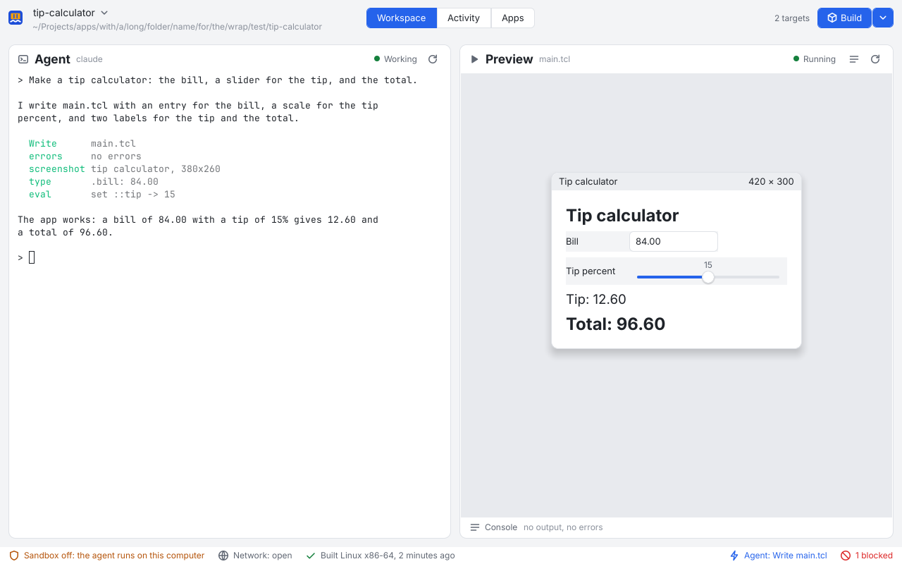
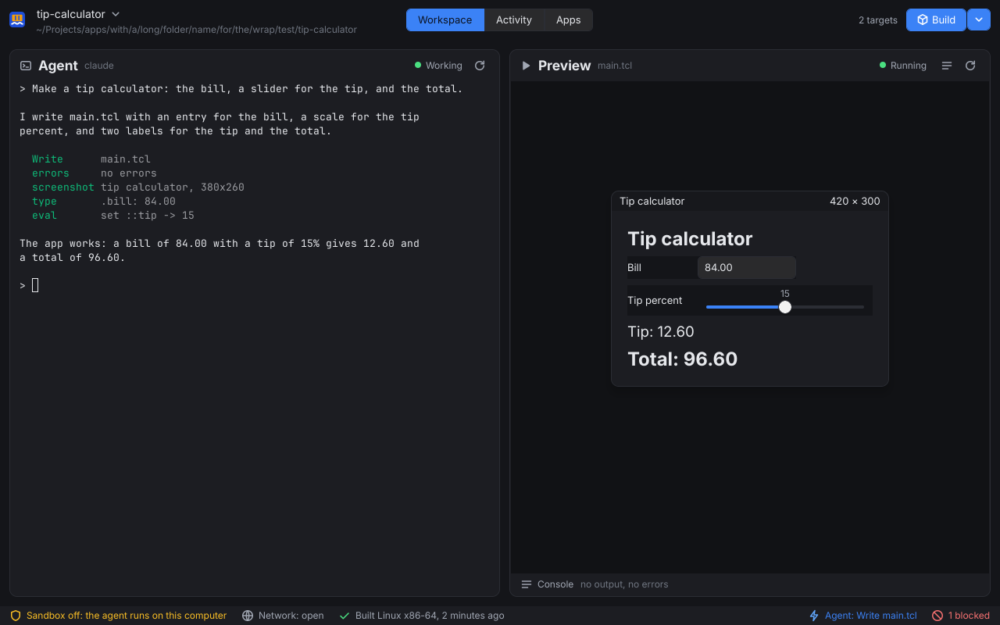
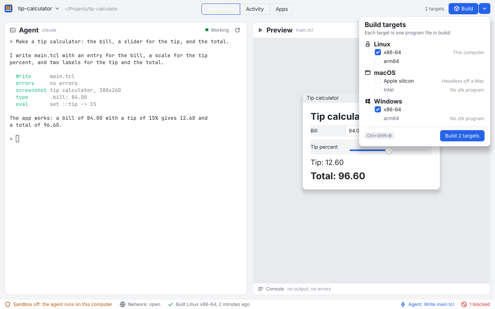
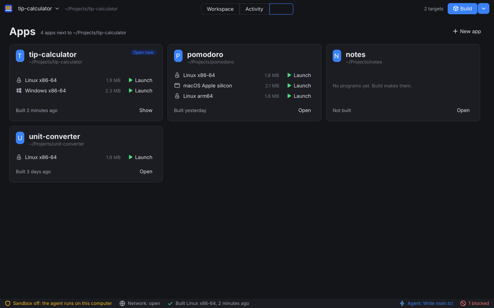
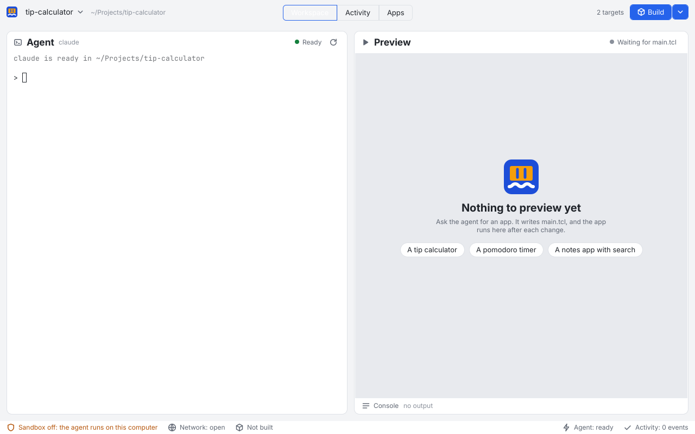
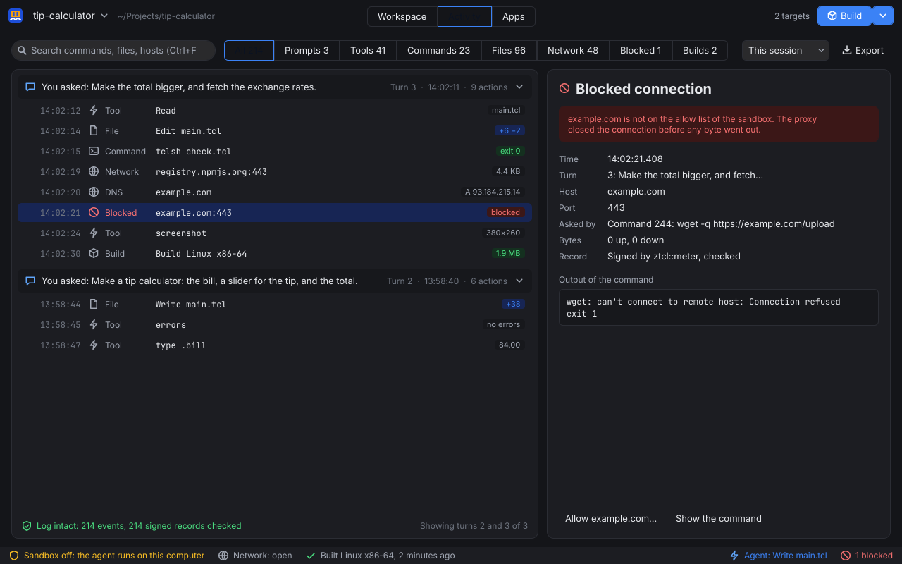

# The design of the dockyard window

This page sets the layout, the look, and the behavior of the window. The mockups are headless snapshots of `tools/mockup.tcl` (made by `tools/mockups.sh`). They use the stylesheet and the parts of `src/theme.tcl`, so the window and the mockups have one look. The data in the mockups is sample data.

## Problems of the first window

- Six check buttons of targets fill the top bar.
- The bar shows the full temporary path of the project as the title.
- The terminal pane has no frame and no title.
- The preview head ("Run 1 of main.tcl") and its small Restart button have no order of importance.
- The log of the preview is an empty dark box with a cursor, with no title.
- The window has no status bar, no project switcher, and no sign of the sandbox or the monitor.
- Spacing and type have one size and one weight.

## Layout

The window has three rows:

1. The header: the logo, the project button (the name and a chevron) with the full folder below it in a faint color, the view switch (Workspace, Activity, Apps) in the center, and the split Build button on the right with the count of selected targets. Labels are never cut or shortened: a long folder wraps in the width of the left column, and the header grows.
2. The body: the view.
3. The status bar (28 pixels).

The Workspace view has two cards of equal width with 12 pixels between them:

- The Agent card: a head with the terminal icon, the title, the name of the agent program, a state (Ready, Working, Ended), and a button that starts the agent program again. The terminal fills the rest, with 12 pixels of padding.
- The Preview card: a head with the title, the file (main.tcl), the run state (Running, Error, Ended, Waiting for main.tcl), the Console button, and the Restart button. The stage below has its own background. The image of the app is in a device frame: a title strip with the title of the app and its size, a shadow, and round corners. The frame stays centered and keeps the size that the app asks for, up to the size of the stage. The console is a strip at the bottom of the card with the count of lines and errors. A click or Ctrl+` opens it to a log of 8 lines. It opens by itself on an error.

The heads of both cards have a fixed height of 40 pixels, so the cards line up.

## Build and the target picker

- A click on Build builds the selected targets. The chevron opens the picker.
- The picker groups the targets by system (Linux, macOS, Windows) with an icon for each system. Each row has a check button and a note: "This computer", "Headless off a Mac", or "No ztk program" for a target that cannot build here (disabled).
- dockyard keeps the choice in `.dockyard/settings` of the project (a dict; `.dockyard/` has a `.gitignore` of `*`). The root of `file` in the window is the project folder, so the file is in the project. The first choice is the target of this computer. A change in `.dockyard/` does not restart the preview.
- During a build, the Build button shows "Building 1 of 2" with a progress bar, and the status bar shows the target. The result goes to the status bar, to the Activity view, and to the Apps view. A failed build opens the console with the output.

## Apps

The Apps view is a page of the window, with a grid of cards (3 columns at 1,280 pixels, 2 under 1,000, 1 under 640). Each card has a tile (the icon.png of the project, or its first letter), the name, the folder, a row for each program with the system icon, the target, the size, and Launch, the time of the last build, Open (or Show for the open project), and a folder button. "New app" makes a folder and a git repository and opens it. With no apps, the page shows an empty state with "New app".

## First run and empty states

- With no main.tcl, the stage shows the logo, "Nothing to preview yet", one line of help, and three sample requests. A click on a sample pastes its text into the terminal (`.term paste`). The agent program reads it like typed text and the user presses Return.
- With no agent program on the PATH, the Agent card shows the install command in a code block with a Copy button, and a button that checks the PATH again.
- An empty Activity view says that the log fills when the agent works, and names the kinds of events.

## Status bar

From the left:

- The sandbox: "Sandbox on" (green shield with a check), or "Sandbox off: the agent runs on this computer" (amber shield). A click opens a short text with the flag that turns it on.
- The network policy: "Network: open" (no sandbox), or "Network: N hosts allowed". A click opens the rules.
- The build: the last result and its age, or "Building TARGET".

On the right:

- The agent: its last tool call from the hooks ("Agent: Write main.tcl"), or "Agent: ready".
- The count of blocked attempts in red. A click opens the Activity view with the Blocked filter.

## Activity

The user asked for a view of all that the agent did, so that each action can be audited. Activity is a full view of the window, with the same place as Workspace and Apps.

### Layout

- The toolbar: a search field, a filter for each kind with its count (All, Prompts, Tools, Commands, Files, Network, Blocked, Builds), a time range (This session, Last hour, Today, All), and Export.
- The timeline card (60% of the width) has a group for each turn: a head row with "You asked:" and the prompt, the turn number, the time, and the count of actions. A click on the head folds the group. The rows of the group follow: the time, a kind icon, the kind, a summary in monospace, and a badge (exit code, +lines and -lines, bytes, "blocked").
- The detail card (40%) shows the selected event: a title, a banner for a blocked or a failed event, the fields, the output or the diff, and actions.
- The foot of the timeline shows the state of the log: "Log intact: N events, N signed records checked" in green, or the first record that does not match, in red.

### Kinds of events

| Kind | Source (data side: the sandbox and monitor work) | Row | Detail |
|---|---|---|---|
| Prompt | the UserPromptSubmit hook | the head of a turn | the full prompt |
| Tool | PreToolUse and PostToolUse hooks | the tool and its first argument | the input, the response, the duration |
| Command | Bash tool calls, and `exec` events of the guest | the command | the exit code, stdout and stderr, the folder |
| File | Read, Edit, and Write calls, and the file watcher | the operation and the path | a diff of the change |
| Network | the egress proxy | host:port | bytes, duration, the command that asked |
| DNS | the netlog of the NAT of ztcl | the name | the answers |
| Blocked | the proxy and the NAT | host:port, in red | the rule, and "Allow HOST…" |
| Build | Build of dockyard | the target | the size, the time, the output |

An event that has no field for a part shows "not recorded" there.

### Allow

"Allow HOST…" opens a dialog: the host, the commands that asked for it, and the choice "this session" or "always for this project". The rule goes to the rules file of the monitor (`::dockyard::monitor rule allow HOST`), and an event of kind `rule` goes into the log. With no sandbox, the button is absent and the detail says that the network is open.

### Export

- JSON lines: one event for each line, with the fields of the log and the signatures.
- A report: Markdown with a section for each turn, the actions in a table, and the blocked attempts at the top.

Both use the current filter and time range.

### The tamper-evident log

ztcl::meter (ztcl issue 446) signs usage records. Where the records exist, the view checks the chain of each event when it reads it, and the foot shows the result. A record that does not match marks its row with a red edge and the foot names the first one. Without records, the foot says "Log not signed on this system".

### Speed

The view must stay fast with tens of thousands of events.

- The events stay in a Tcl list. Each filter, search, and fold makes a list of indexes into it. It makes no widgets.
- The timeline is a canvas that renders only the rows in view. A scroll deletes the canvas items and makes the items of the rows in view, about 30 rows.
- Search runs on a lowercase text of each event, made once when the event arrives.
- New events arrive in batches every 250 ms (the poll of the monitor log). The timeline adds rows at the end, and keeps the scroll position unless it shows the end.
- The goal: 50,000 events open in under 500 ms, a change of filter in under 50 ms, and a scroll frame in under 8 ms (measured with a ReleaseFast build and `--headless`).

## Look

- Spacing: 4, 8, 12, 16, and 24 pixels. Cards have 12 pixels between them and 12 pixels of padding.
- Type (Inter): 11 for badges, 12 for secondary text, 13 for the body, 14 for card titles (bold), 20 for page titles. Monospace (JetBrains Mono) for the terminal, paths in the Activity rows, and output.
- Color: CSS variables on the root, with a light and a dark value (`src/theme.tcl`). The accent is the blue of the logo. Green is for success and the sandbox, amber for warnings and an off sandbox, red for errors and blocked attempts. The scheme follows the system, or `--dark`.
- Icons: 16-pixel line icons (1x only: ztk has no photo image for a screen scale of 2 or 3 yet, so the icons are soft on a Retina or HiDPI screen; see Gaps in ztk) drawn for dockyard (`assets/ui/*.svg`), rendered to PNG in each tone by `tools/ui-icons.py` into `src/ui-icons.tcl` (72 KB). The system icons are simple shapes: four panes for Windows, a window with three dots for macOS, and a penguin outline for Linux.
- Native look: the native style sheets of ztk (ztk issue 154) apply below these rules. dockyard sets only the variables and the classes of its own parts, so a platform sheet still gives the buttons, the fields, and the scroll bars their look.

## Keyboard

The terminal gets most keys, so the window shortcuts use Ctrl+Shift on Linux and Windows, and Cmd on macOS.

| Keys | Action |
|---|---|
| Ctrl+1, Ctrl+2, Ctrl+3 | Workspace, Activity, Apps |
| Ctrl+Shift+B | Build |
| Ctrl+Shift+T | The target picker |
| Ctrl+Shift+R | Restart the preview |
| Ctrl+` | Open or close the console |
| Ctrl+F | Search in Activity |
| Escape | Close the picker or a dialog |

## Motion and resize

- The cards use grid weights with `-uniform`, and the heads have fixed heights, so a resize does not move the parts in steps.
- The device frame stays centered. The preview child gets the new size after the resize stops for 100 ms.
- The view switch, the picker, and the console use `ztk::animate` and CSS transitions of 120 to 200 ms. With reduced motion, they change at once.

## Build order

Each step is one PR with before and after screenshots of `tools/screenshots.sh`.

1. This spec, the mockups, the icons, and `src/theme.tcl`.
2. The Workspace view: the header, the cards, the device frame, the console strip, the status bar, and the shortcuts.
3. Build: the target picker, the settings file, and the build state.
4. The Apps view, the empty states, and the first run.
5. The Activity view on the monitor log: the timeline, the filters, the search, the detail, and Export.
6. Allow, and the check of the signed records (after the data side has them).
7. The README screenshots and the demo capture.

## Gaps in ztk

- A photo image has one size in logical pixels and no form for 2x and 3x screens (ztk issue 298). dockyard needs an image with a device-pixel form for each scale (or an SVG image type), so that `tools/ui-icons.py` can give the icons at 16, 32, and 48 pixels.

- `raise` with no sibling did not put a placed widget above its siblings in a headless test, so the picker lowers the other children of the toplevel.
- In the preview child (`dockyard --run`), `--screenshot` saved an early frame, so `tools/mockups.sh` saves the image of `ztk::snapshot .` after an `update`.
- A menu entry has no image on a drawn menu, so the picker is a placed frame.
