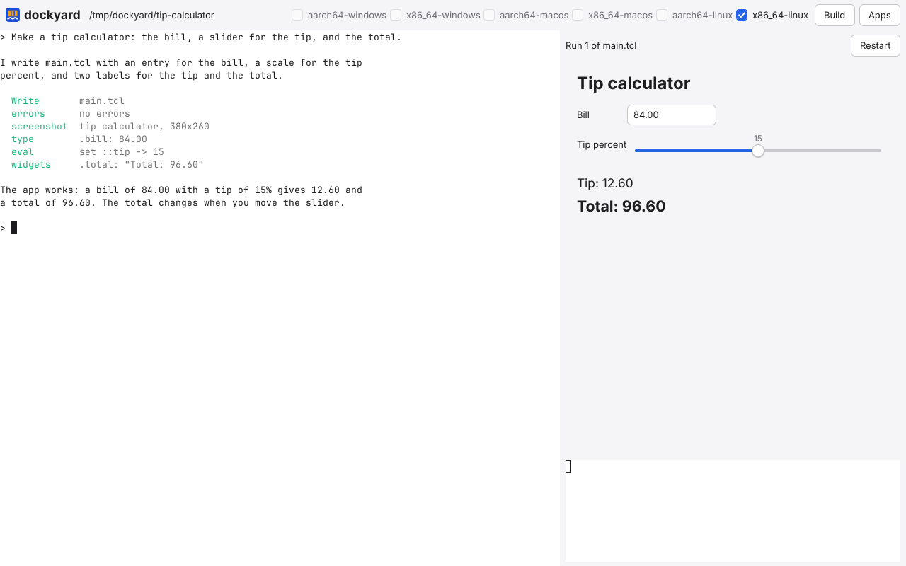

# User guide



This guide tells you how to use dockyard. dockyard is a desktop app. You chat with an agent program in a terminal pane, and the agent program writes a ztk app. The preview pane shows the app while the agent program writes it.

## Start dockyard

Give the folder of a project:

```sh
dockyard ~/dockyard/my-app
```

With no folder, dockyard uses the current folder. A project is a folder with a git repository. The first script of the app is `main.tcl`.

The flags:

| Flag | What it does |
|---|---|
| `--agent PROGRAM` | Runs `PROGRAM` in the terminal pane. The default is `claude` from the `PATH`. |
| `--dark` | Uses the dark color scheme. |
| `--headless` | Uses the headless backend. The window is not on the screen. |
| `--exit-after-frames N` | Exits after `N` frames. |
| `--exit-after-ms N` | Exits `N` ms after the start. |
| `--screenshot FILE.png` | With `--headless`: writes the last frame to `FILE.png` at the exit. |
| `--sandbox DIR` | Runs the terminal pane in a guest of `ztcl::vm`, with the kernel and the agent of DIR. See [the sandbox](sandbox.md). |
| `--sandbox-command LIST` | The program of the pane in the guest. The default is `/bin/busybox sh -l`. |
| `--monitor` | Opens the [monitor](monitor.md) of the project in place of the window. With `--tui`, it writes the events to the terminal. |
| `--mcp` | Serves the MCP tools on stdin and stdout. The agent program starts it from `.mcp.json`. |

## The window

The window has two panes:

- The terminal pane, on the left, runs the agent program in the project folder.
- The preview pane, on the right, runs `main.tcl` of the project.

### The terminal pane

The terminal pane is a `ztk::terminal` widget. It runs `claude` when the `PATH` has it. When the `PATH` does not have `claude`, the pane runs your shell and shows the install command. Type `exit` after the install, and dockyard starts `claude`.

When the program ends, press Return to start it again.

The program in the terminal pane runs with the full power of your user. Read [security.md](security.md).

### The preview pane

The preview pane runs `main.tcl` in a child process (`dockyard --run main.tcl --headless`). The pane shows the image of the window of the child, and sends your clicks and keys to it.

- The file watcher sees each change in the project folder. 150 ms after the last change, the pane starts the child again. Changes in `.git` do not start the child.
- The output of the app (`puts`) and its errors show below the image.
- The Restart button starts the child again.
- The size of the pane is the size of the window of the child.

A new run starts the state of the app again.

## The MCP tools

dockyard writes two files into a project that does not have them:

- `.mcp.json` tells the agent program to start `dockyard --mcp`, the MCP server of dockyard.
- `CLAUDE.md` tells the agent program about ztk, the preview, and the tools.

A file that exists stays as it is. The agent program asks you to approve the server of `.mcp.json` before it uses it.

The MCP server connects to the preview child. The tools:

| Tool | What it does |
|---|---|
| `screenshot` | Gives a PNG image of the preview window, or of one widget. |
| `widgets` | Gives the widget tree, with the class, the geometry, and the text of each widget. |
| `eval` | Runs Tcl in the preview interpreter. |
| `click` | Presses and releases a mouse button at a point. |
| `type` | Types text into the widget with the focus, or into a given widget. |
| `key` | Presses one key, for example `Return` or `Control-a`. |
| `scroll` | Turns the mouse wheel at a point. |
| `errors` | Gives the errors since the last call, with the Tcl traces. |
| `log` | Gives the output of the app since the last call. |
| `restart` | Runs `main.tcl` again. |

With these tools, the agent program gets images of the app and tests it.

## Build

The bar has a check button for each target of `ztk bundle`: `x86_64-linux`, `aarch64-linux`, `x86_64-macos`, `aarch64-macos`, `x86_64-windows`, and `aarch64-windows`. The target of your computer is on at the start. A target is off and gray when the ztk program of the target is not next to dockyard.

Click Build. For each selected target, dockyard copies the ztk program of the target and puts the app in it (`ztk bundle`). The output is one program file, `build/TARGET/NAME` in the project, with `.exe` for Windows. `NAME` is the name of the project folder. The bar shows the result. An error shows in the output pane below the preview.

`icon.png` of the project, a square PNG, is the icon of the program: the icon resource of a Windows program, and `NAME.desktop` with `NAME.png` next to a Linux program. A Windows program takes a PNG of 256 pixels or less, or `icon.ico` of the project when it has one. The app is `main.tcl` and the other files and folders of the project. The program leaves out the hidden files, `build/`, `CLAUDE.md`, and `LICENSE`. The program gets the capabilities of the preview: `file`, `channels`, and `clock`.

The ztk programs of the targets are in `lib/ztk/runtime/TARGET/` next to the `bin` folder of dockyard. `zig build` makes the program of the target of the build. `zig build -Druntimes=all` makes the programs of all the targets, and `-Druntimes=x86_64-linux,x86_64-windows` makes a list of them.

These limits come from the builds of ztk on another system:

- A Linux program for another target has the direct and the headless backends, with no Wayland window.
- A macOS program made on Linux or Windows has only the headless backend. The AppKit backend needs the macOS SDK, so build dockyard on a Mac for a macOS window.

## The app list

Click Apps. The app list shows each folder next to the project folder that has a `main.tcl` (for example, each app in `~/dockyard/`). Below each app, the list shows its programs in `build/`, with the target and the size.

- Launch starts the selected program.
- Open in dockyard starts a new dockyard window for the selected app.

The list fills again after each build.
