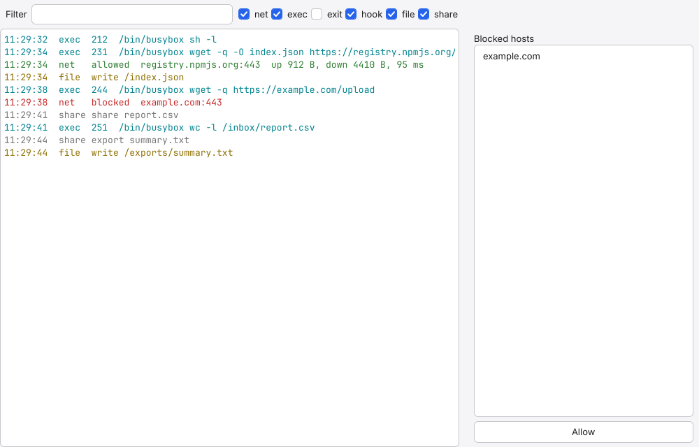
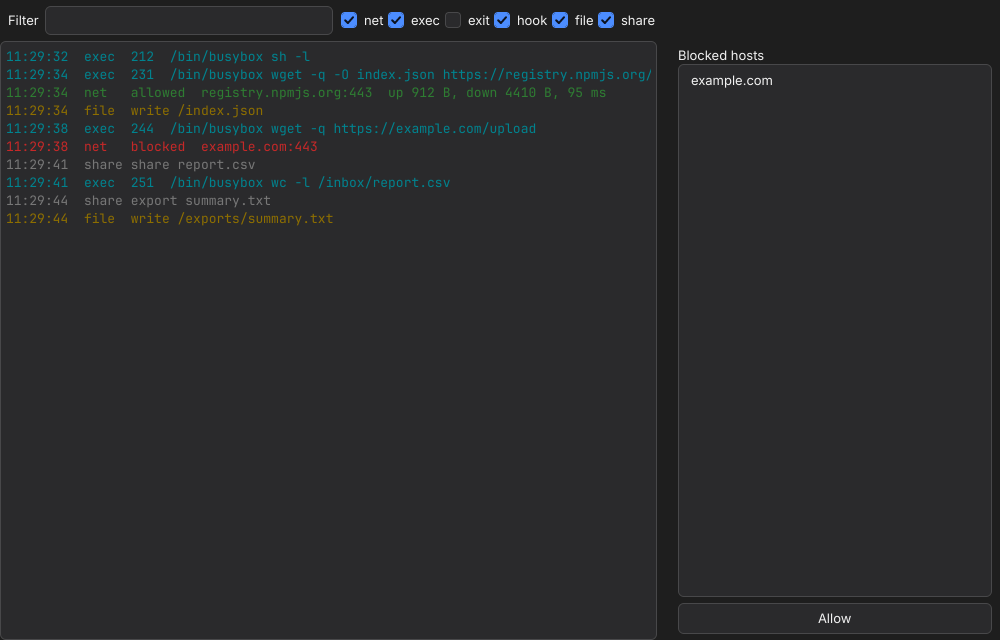

# The monitor

The monitor shows what the sandbox does while the agent program works: each network call through the proxy, allowed or blocked, each program that starts in the guest, each tool call of the agent program, each change of the project folder, and each share. Open it next to a dockyard window that runs with `--sandbox`.

```sh
dockyard --monitor ~/dockyard/my-app          # a window
dockyard --monitor --tui ~/dockyard/my-app    # one colored line for each event, in the terminal
```

It is one program with two views: the window and the terminal view run the same script.



<details><summary>The dark color scheme</summary>



</details>

## The window

- **The timeline** lists each event, with a color for each kind. New events come at the end.
- **The filter** keeps the events whose text has the words that you type.
- **A check button for each kind** (`net`, `exec`, `exit`, `hook`, `file`, `share`) shows or hides that kind. `exit` is off at the start.
- **The tray of blocked hosts** lists each host that the proxy blocked. Select a host and click Allow. The next connection to that host goes through.

## The events

| Kind | What it shows | From |
|---|---|---|
| `net` | A connection: the host, the port, `allowed`, `blocked`, `failed`, or `refused`, the bytes up and down, and the time in ms | The egress proxy, every 250 ms |
| `exec`, `exit` | A program of the guest that starts, with its arguments, or ends | The helper of the guest, which reads `/proc` every 50 ms |
| `hook` | A hook of the agent program: the event, the tool, and its first input, such as the command or the path | The hooks of Claude Code in the guest, through the helper |
| `file` | A file of the project that changes, is made, or is removed | The file watcher of the preview |
| `share` | A share, a revoke, or an export of the Shares panel | The panel |
| `rule` | A host that you allowed or blocked | The monitor |

## Where the log is

The dockyard window writes the log. The monitor reads it, so you can open and close the monitor at any time.

The log is outside the project folder, because the guest can write the project folder: `$XDG_RUNTIME_DIR/dockyard-HASH.monitor`, or a file in `/tmp` with your user ID in its name, with mode 0600. Your rules are in `dockyard-HASH.rules` next to it. The dockyard window reads the rules every 250 ms and gives the proxy its new allow list.

## Not in the monitor yet

- The files that the guest reads. Only the changes are in the log.
- A program of the guest that runs for less than 50 ms can be missing.
- The metrics of the agent program, the diff of each step, and a replay of a session.
